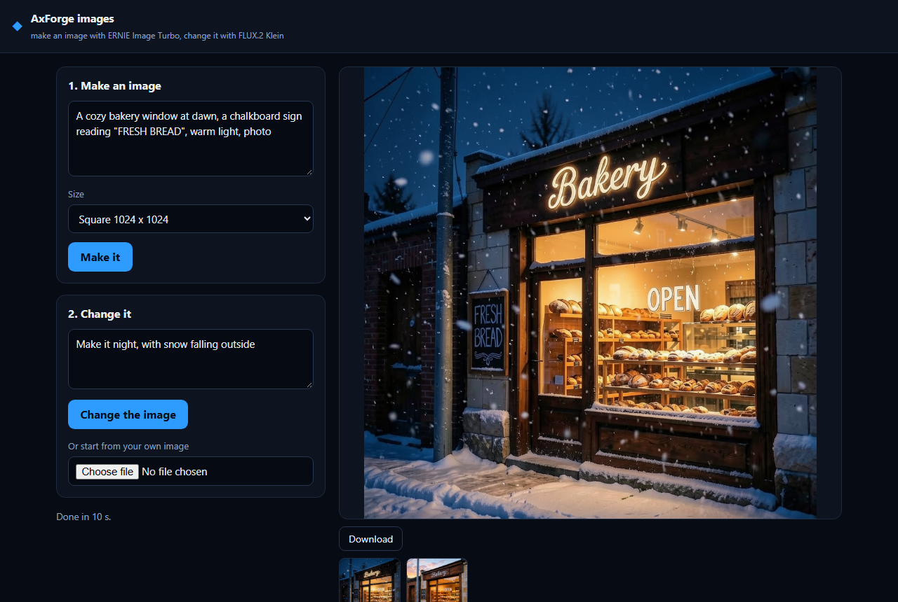

# AxForge images

Make an image from a few words, then change it with an instruction, on the [AxForge](https://axforge.ai) API.
Plain HTML and JavaScript, plus a small Node.js server that keeps your API key. No dependencies and no build step.



## What it uses

| Model | API model name | Endpoint | What for |
|---|---|---|---|
| ERNIE Image Turbo | `ernie-image-turbo` | `POST /v1/images/generations` | A new image from a prompt, including clear words inside the image |
| FLUX.2 Klein 4B | `flux2-klein-4b` | `POST /v1/images/edits` | An existing image changed by an instruction |

Both return a PNG as base64 in `data[0].b64_json`. See the [images docs](https://dev.axforge.ai/docs/images/).

## Run it, step by step

1. **Node.js 22 or newer.** Check with `node --version`. Get it from [nodejs.org](https://nodejs.org).
2. **Get the code.** Clone this repository, or download it as a ZIP and unpack it. Then open a terminal in the
   folder.
3. **Get an API key.** Sign in at [console.axforge.ai](https://console.axforge.ai/keys) and make a key.
4. **Put the key in `.env`.** Copy the example file:
   - macOS and Linux: `cp .env.example .env`
   - Windows: `copy .env.example .env`

   Open `.env` and paste your key after `AXFORGE_API_KEY=`.
5. **Start it:**

   ```
   npm start
   ```

   Open http://127.0.0.1:3000. Press **Make it** to make the example image, then **Change the image**. Press Ctrl+C in
   the terminal to stop the server.

There is nothing to install: `npm start` only runs `node server.js`.

## How it works

| File | What it does |
|---|---|
| `server.js` | Serves the page and forwards `/api/generate` and `/api/edit` to the AxForge API with your key |
| `public/index.html` | The page: the prompt, the instruction, the image and the earlier images |
| `public/app.js` | Sends the prompt or the instruction with the current image, and shows the PNG that comes back. Start here |
| `public/style.css` | The look, safe to replace |

The two calls, in the OpenAI images shape:

```js
// a new image
await fetch("https://api.axforge.ai/v1/images/generations", {
  method: "POST",
  headers: { Authorization: `Bearer ${process.env.AXFORGE_API_KEY}`, "Content-Type": "application/json" },
  body: JSON.stringify({ model: "ernie-image-turbo", prompt: "A poster reading \"GRAND OPENING\"", size: "1024x1024" }),
});

// the same image, changed
await fetch("https://api.axforge.ai/v1/images/edits", {
  method: "POST",
  headers: { Authorization: `Bearer ${process.env.AXFORGE_API_KEY}`, "Content-Type": "application/json" },
  body: JSON.stringify({ model: "flux2-klein-4b", prompt: "Make it night", image: "data:image/png;base64,..." }),
});
```

## Tips

- **Words in the image:** put the exact words in quotes in the prompt. ERNIE draws text well.
- **To change words already in an image,** make it again with the new words, rather than editing. Editors are good
  at light, weather, colors and objects, and less good at letters.
- **Time:** a new image takes tens of seconds, and a change takes about ten.
- **Your own photo** is scaled down to at most 1536 pixels a side before it is sent, which keeps the upload small.

## Good to know

- **Your key stays on the server.** The page only talks to `server.js`, which listens on 127.0.0.1, so only your own
  computer can reach it. Before you put it online, add your own sign-in, so strangers cannot spend your key.
- **Images are not stored.** They live in the page until you close it. Use Download to keep one.
- **Prices:** see the [pricing page](https://axforge.ai/pricing/).

## License

MIT, see [LICENSE](LICENSE).
